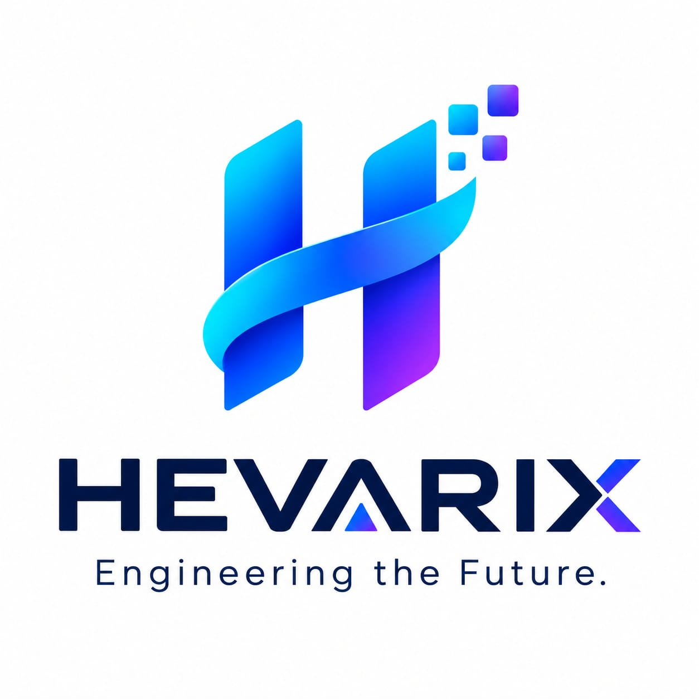

  

<h3 align="center">Engineering the future.</h3>

**Hevarix** is a European software company building AI products that solve concrete problems for teams and organizations. We design each product around three principles: it has to be trustworthy, confidential by design, and simple enough to adopt without a project of its own.

Based in Brussels. Incubated at [WeAreFounders](https://www.wearefounders.eu), powered by BeCentral.

## Our products

| Product | What it does | Status |
|---|---|---|
| **Hasper** | An AI agent that acts as a project's living memory. It answers questions with sourced answers, guides newcomers through a validated onboarding journey, and captures the knowledge of people who leave. | In design and early development |

More products will follow. Each one gets its own place here as it takes shape.

## How we build

- **Confidential by design.** Client data stays with the client, and access follows each person's rights.
- **Built in Europe.** Data protection (GDPR) and the EU AI Act shape our design from day one.
- **Trustworthy answers.** Our agents answer from sources, or they say they don't know.
- **Humans stay in charge.** Our AI proposes, people validate and decide.

## Follow along

- LinkedIn: [Hevarix](https://www.linkedin.com/company/hevarix)

Interested in being an early pilot partner? Reach out through LinkedIn.
